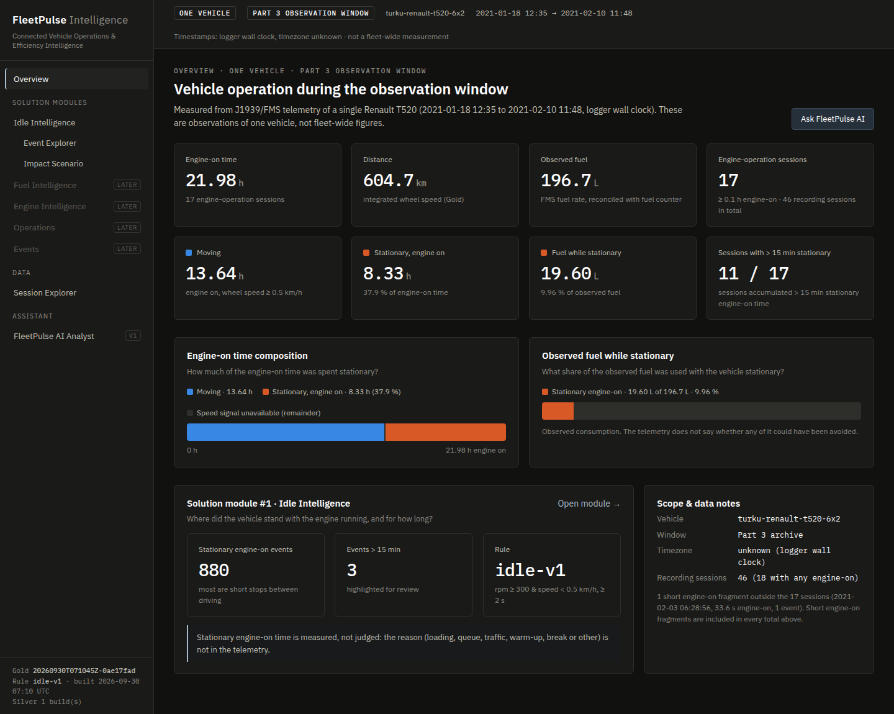
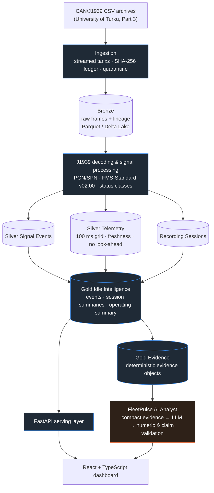
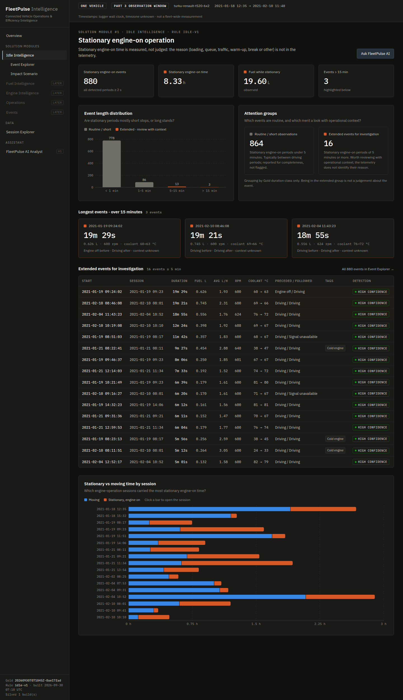
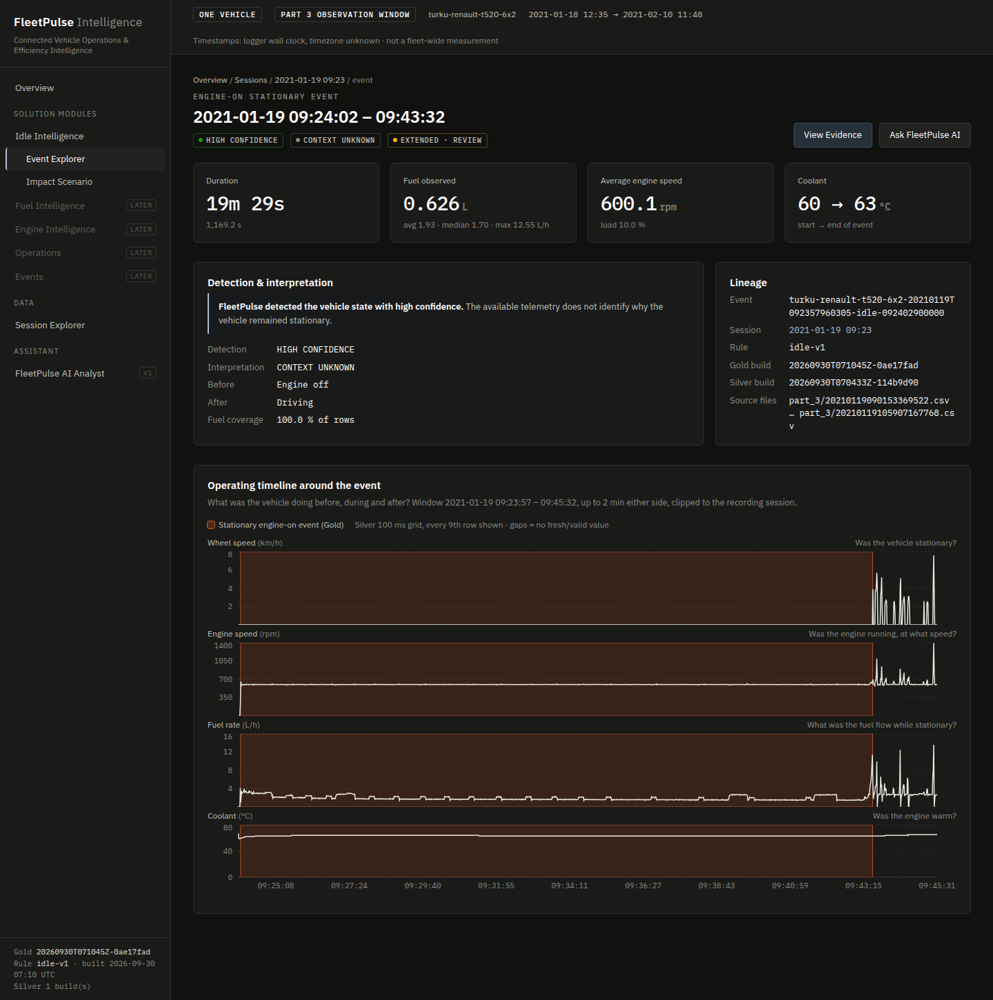
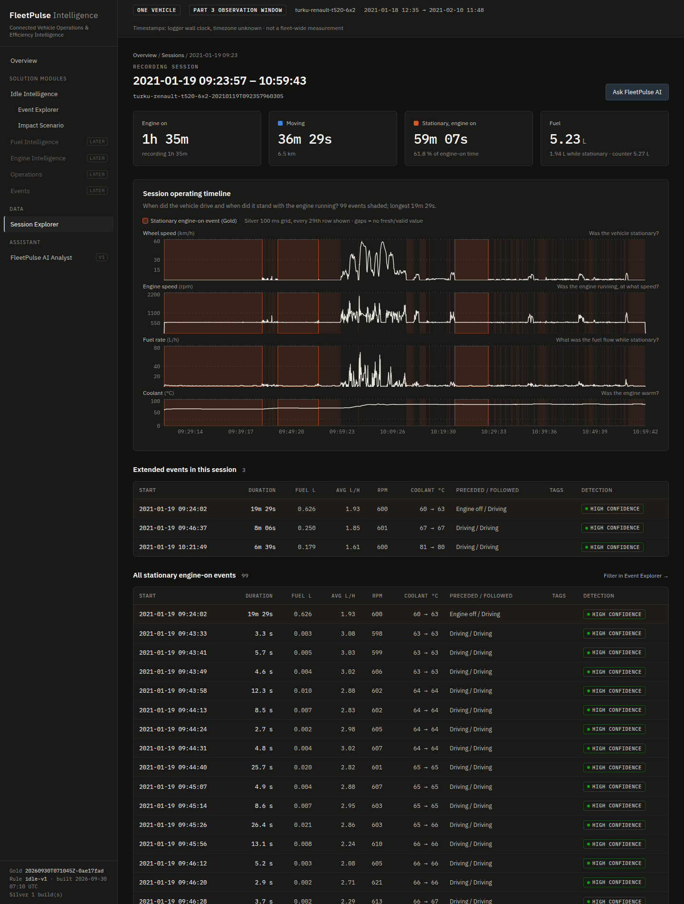
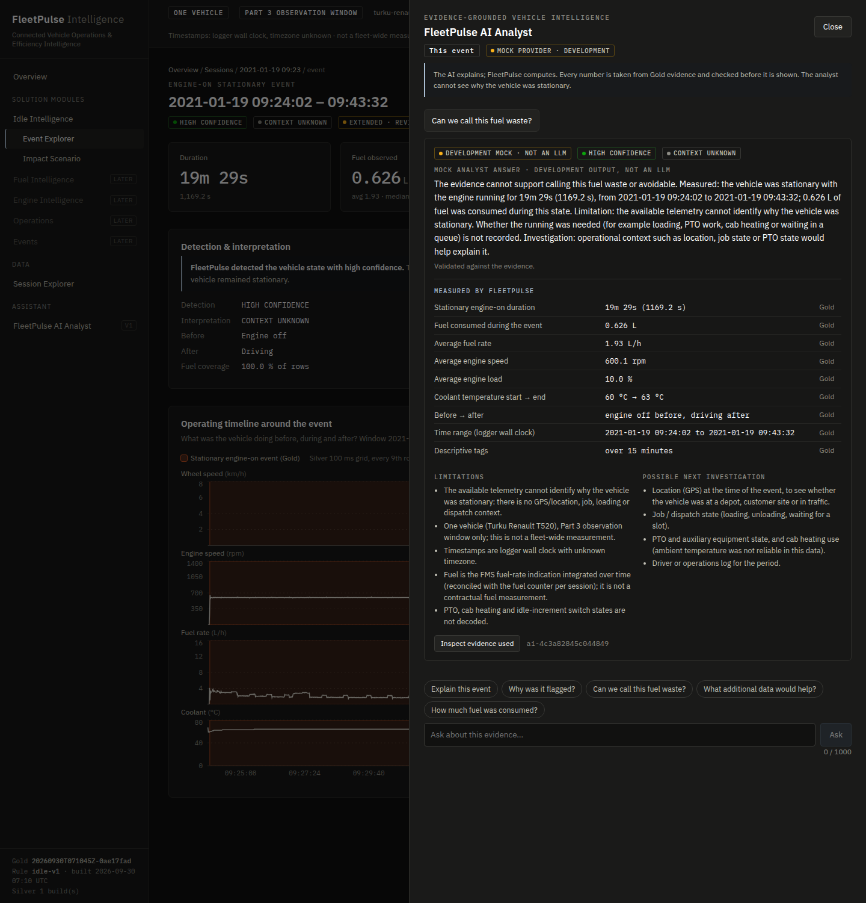

# FleetPulse Intelligence

**Connected Vehicle Operations & Efficiency Intelligence from raw heavy-duty vehicle CAN/J1939 telemetry.**

FleetPulse turns raw CAN traffic from a real heavy-duty truck into traceable operational intelligence. Every figure on the dashboard traces back through a deterministic pipeline to the CAN frames it came from. An evidence-grounded AI layer explains those figures without ever computing them.



---

## The problem

A truck's CAN bus produces thousands of frames per second. That raw traffic is not something an operations team can act on. It is:

- binary J1939 payloads;
- messages arriving at different rates;
- gaps in logging;
- stale signals;
- "not available" codes.

The questions fleet operators care about sit several layers above it: how the vehicle was actually used, how long it stood with the engine running, and where that happened. Answering them credibly means:

- decoding the signals against an authoritative standard;
- proving the data is complete;
- defining vehicle states deterministically;
- being honest about what the data **cannot** tell you.

## The platform

```
Raw CAN/J1939 → Bronze → Silver → Gold → FastAPI → React dashboard → Evidence-grounded AI Analyst
```



> **FleetPulse computes. The LLM explains.** Vehicle metrics are produced only by the deterministic pipeline. The AI Analyst receives compact Gold evidence, and each answer is checked against that evidence before it is shown.

## The result

Built on **Part 3** of a real heavy-duty truck dataset: one Renault T520 6x2, observed between 2021-01-18 and 2021-02-10 (logger clock).

| | |
|---|---|
| CAN frames processed for the Gold build | **68,051,361** (1,361 source files) |
| Engine-on time | **21.98 h** |
| Distance | **604.7 km** |
| Observed fuel | **196.7 L** (FMS fuel rate, within 0.2 % of the vehicle's fuel counter) |
| Stationary with engine running | **8.33 h** (37.9 % of engine-on time) |
| Fuel consumed during that observed state | **19.60 L** (9.96 % of observed fuel) |
| Stationary engine-on events | **880**, of which 778 lasted under 1 minute, 16 were 5 minutes or longer, and 3 exceeded 15 minutes |
| Engine-operation sessions with > 15 min accumulated stationary engine-on time | **11 / 17** |
| Automated tests | **355** |

The 19.60 L is **observed consumption during a measured vehicle state**. The telemetry holds no location, job, PTO or driver context, so FleetPulse does not label any of it as waste, avoidable or a potential saving. Stationary running can be legitimate: loading, queuing, warm-up, cab heating, auxiliary equipment.

## How the use case was found

The product was **not** decided up front. It came out of the data:

```
raw telemetry
  → understand the signals      (J1939 identifier parsing, FMS-Standard v02.00 coverage matrix, 12 verified SPNs)
  → establish data quality      (status classes, recording-gap audit across the whole archive, counter reconciliation)
  → analyse operating behaviour (driving, stationary, coasting, cold starts, high-fuel-rate bursts)
  → discover a repeated pattern (stationary engine-on operation in 5/5 sampled driving sessions; > 15 min in 11/17 sessions)
  → quantify it                 (8.3 h and 19.6 L archive-wide; evidence matrix against five other candidates)
  → build Idle Intelligence     (Gold rule idle-v1, dashboard, evidence objects)
```

- **Candidates weighed.** Business Discovery V1 evaluated six candidate problems: stationary engine-on time, low-mobility sessions, high-fuel-rate bursts, cold-start warm-up, coasting and cruise use. Each had its own evidence and limitations.
- **Selection.** Stationary engine-on operation was chosen because it recurs, is measurable with verified signals, and reconciles with the vehicle's own fuel counter. See [business_discovery_v1.md](docs/business_discovery_v1.md).

## Engineering decisions

| Area | Decision |
|---|---|
| **Decoding** | J1939 29-bit identifiers parsed into priority, PGN (PDU1/PDU2) and source address. Only signals verified against FMS-Standard v02.00 are decoded, each classified as valid, out-of-range, error, not-available or missing-bytes. Unknown PGNs are counted, never guessed. |
| **Deterministic ingestion** | Archives are streamed without extraction. Each source file carries a **SHA-256** checksum in an ingestion ledger: re-runs skip unchanged files, and a changed file with the same name is surfaced as a conflict rather than silently overwritten. |
| **Quarantine** | Malformed records are kept, with their raw text and failure reasons. Per source file, valid + quarantined must equal an independent raw line count, or the batch fails. |
| **Storage** | PySpark jobs with Parquet or **Delta Lake** tables (ACID commits, idempotent Silver/Gold rebuilds). Delta parity with Parquet is tested; the Part 3 Gold build used the Parquet store. |
| **Recording sessions** | Continuity is segmented at gaps longer than 1 s, based on a gap audit of the whole archive. A session is data continuity, not a trip. |
| **Message freshness** | Every signal on the 100 ms telemetry grid is the latest frame at or before that time, valid only within 3× its FMS repetition period. Status and age columns explain every NULL. |
| **No interpolation, no look-ahead** | Stale signals become NULL instead of being filled, and nothing crosses a session boundary. |
| **Lineage** | Rows carry source archive, file, line, ingestion run and build IDs through Bronze, Silver and Gold. |
| **Deterministic Gold metrics** | The Idle Intelligence rule (`idle-v1`: rpm ≥ 300, speed < 0.5 km/h, both fresh and valid, ≥ 2 s) is versioned and configurable. Integrated fuel is reconciled against the fuel counter per session. |
| **Serving** | FastAPI serves Gold as-is. The React frontend formats values and computes no metrics. |
| **AI boundary** | The LLM receives a compact evidence package, not telemetry. Numbers and claims are validated, with a deterministic fallback. |

Details: [architecture_v1.md](docs/architecture_v1.md) · [bronze.md](docs/bronze.md) · [silver.md](docs/silver.md) · [delta_lake.md](docs/delta_lake.md) · [recording_sessions.md](docs/recording_sessions.md) · [signal_definitions.md](docs/signal_definitions.md)

## Dashboard

A dark, desktop-first operations UI (React 19 + TypeScript + Recharts). It is labelled throughout as **one vehicle / Part 3 observation window**. Traceability runs KPI → session → event → evidence object.

| Idle Intelligence | Event detail |
|---|---|
|  |  |
| Short routine stops are separated from the 16 extended events that merit review with operational context. | One event with its measured values, detection confidence ("high"), interpretation status ("context unknown") and Silver telemetry around it. |

| Session timeline | AI Analyst (mock provider) |
|---|---|
|  |  |
| Speed, engine speed, fuel rate and coolant for a recording session, with the Gold events shaded. | Asked "Can we call this fuel waste?", the analyst declines to make the claim and separates what was measured from what is unknown. |

See [dashboard_v1.md](docs/dashboard_v1.md) for all screens and the Gold-to-UI mapping.

## AI Analyst: current status

- **What the demonstrated build runs.** AI Analyst V1 runs with a development `MockAIProvider`: deterministic template answers, labelled "not an LLM" in the API and the UI.
- **Real provider adapters** exist for the Anthropic Messages API and OpenAI-compatible APIs. They are contract-tested against simulated HTTP responses but **have not yet been validated against live model output**. No production LLM is running.
- **Behaviour without a provider.** Nothing is configured by default. In that state the analyst reports itself unavailable and the rest of the dashboard works normally.

The architecture is in place and tested end to end:

```
Gold evidence → compact evidence package → provider (LLM or mock)
             → numeric / timestamp / claim-policy / leakage validation
             → validated answer, one corrective retry, or deterministic fallback
             → audit record
```

- **Evidence only.** The AI does not calculate vehicle metrics. It never sees raw CAN or telemetry tables. Scenario figures are computed by the Gold scenario engine before the model sees them.
- **Claim policy.** A machine-readable policy blocks statements of fact about fuel waste, avoidable idling, driver fault, savings, mechanical faults, the cause of a stop and fleet-wide behaviour.
- **Validation.** Numbers are checked against the evidence and must match in unit as well as value.

See [ai_analyst_v1.md](docs/ai_analyst_v1.md).

## Project structure

```
src/fleetpulse/
  ingestion/, j1939/, telemetry/, validation/, analysis/   reference decoder & validation (pandas)
  bronze/                   Spark ingestion, checksum ledger, quarantine, Parquet/Delta stores
  silver/                   J1939/FMS decoding, recording sessions, 100 ms telemetry alignment
  gold/                     Idle Intelligence rule, summaries, scenario engine, evidence objects
  discovery/                archive screen and business discovery analysis
  pipelines/                runnable entry points (python -m fleetpulse.pipelines.<name>)
  api/                      FastAPI serving layer
  ai/                       AI Analyst: evidence retrieval, providers, validation, claim policy, audit
frontend/                   React + TypeScript dashboard (Vite)
config/                     archive member lists for each documented run
tests/                      355 tests
docs/                       design and results documentation
reports/                    dashboard screenshots and analysis figures
```

## Running locally

### 1. Python environment

- **Requirements:** Python ≥ 3.11 and Java 17 (for PySpark).
- **Conda is the simplest route**, because it provides both.

```bash
conda create -n fleetpulse python=3.11 openjdk=17 -c conda-forge
conda activate fleetpulse
pip install -e ".[spark,api,analysis,dev]"
```

### 2. Dataset

The raw data is **not** included (see [Data and licence](#data-and-licence)). Download the Part 3 archive from the dataset record and place it unchanged at `data/raw/part_3.tar.xz`. See [data/README.md](data/README.md).

### 3. Pipeline (Part 3 Gold build)

Commands as used for the documented build. `--master local[2]` keeps a laptop responsive.

```bash
python -m fleetpulse.pipelines.bronze_ingest --archive data/raw/part_3.tar.xz \
    --include-list config/gold_part3_engine_sessions.txt --root data/gold_part3/bronze --master "local[2]"
python -m fleetpulse.pipelines.silver_build --bronze-root data/gold_part3/bronze \
    --silver-root data/gold_part3/silver --master "local[2]"
python -m fleetpulse.pipelines.gold_build --silver-root data/gold_part3/silver --gold-root data/gold_part3/gold
```

- **Delta Lake storage:** add `--format delta` to Bronze and Silver; see [delta_lake.md](docs/delta_lake.md).
- **Smaller development subset:** use `config/bronze_subset_part3.txt`, which is 10 files.

### 4. API

```bash
cp .env.example .env              # FLEETPULSE_AI_PROVIDER=mock for the development analyst; leave unset to disable
set -a; source .env; set +a
uvicorn fleetpulse.api.app:app --port 8000     # from the repository root; API docs at /docs
```

### 5. Frontend

```bash
cd frontend
npm install
npm run build        # served by the API at http://localhost:8000
npm run dev          # or: hot-reload dev server on :5173, proxying /api to :8000
```

### 6. Tests

```bash
pytest
```

Most tests use synthetic fixtures. Tests that need the extracted Part 3 files (reference-parity checks) or the local Part 3 Gold build (API and AI contract tests) are skipped when those are absent, so a clone without the dataset runs a reduced suite. All 355 run with the data in place.

## Testing

**355 tests** protect:

| Area | What is protected |
|---|---|
| Ingestion | CSV parsing edge cases, SHA-256 replay and conflict handling, quarantine accounting, idempotent re-runs |
| Decoding | J1939 identifier/PGN parsing, FMS scaling and status classes (valid, error, not-available, out-of-range) |
| Silver | recording-session segmentation, freshness semantics, no look-ahead, parity with the reference decoder |
| Delta Lake | transactional commits, recovery, rebuild idempotency, Parquet ↔ Delta parity |
| Gold | event detection boundaries, fuel integration, counter reconciliation, scenario inputs |
| API | exact Gold values served, pagination and filters, 404/422 handling, wording contract |
| AI Analyst | evidence retrieval, routing through the Gold scenario engine, hallucinated numbers, prohibited claims, prompt injection, secret leakage, timeouts and fallback, audit |

## Limitations

- **One truck** (Renault T520 6x2) and **one archive part** (Part 3) for the product V1. Parts 1, 2 and 4 are not processed.
- **Observation span:** roughly three weeks (2021-01-18 → 2021-02-10), with most distance on four days.
- **Timestamps** are the logger's wall clock; the **timezone is unknown**, so there is no day or shift reporting.
- **No GPS, job, driver or PTO context.** The reason for any stationary engine-on period is unknown, so stationary operation **cannot be classified as waste** automatically.
- **Rule thresholds** (300 rpm, 0.5 km/h, 2 s, 5- and 15-minute classes) are documented development defaults derived from this dataset, not industry standards.
- **AI Analyst** is demonstrated with the mock provider only; the live-LLM adapters have not been validated.
- **Scale.** This is a local, single-machine portfolio platform (Spark `local[*]`, API without authentication), not production fleet infrastructure.

## Roadmap

These items are **not** implemented yet:

- Fuel Intelligence (high-fuel-rate operation, cold-start warm-up), built from the other discovery candidates
- validation on additional archive parts
- multi-vehicle data model and serving
- validation of real LLM providers against the answer validator
- cloud deployment
- additional operational context (location, job, PTO) to move events beyond "context unknown"

## Documentation

| Document | Contents |
|---|---|
| [architecture_v1.md](docs/architecture_v1.md) | layer design, principles, lineage |
| [signal_definitions.md](docs/signal_definitions.md) | verified PGN/SPN definitions and their sources |
| [recording_sessions.md](docs/recording_sessions.md) | gap audit and session segmentation |
| [bronze.md](docs/bronze.md) | ingestion, checksum ledger, quarantine |
| [silver.md](docs/silver.md) | decoding, telemetry alignment, freshness |
| [delta_lake.md](docs/delta_lake.md) | Delta Lake storage and parity |
| [business_discovery_v1.md](docs/business_discovery_v1.md) | exploratory analysis and candidate problems |
| [gold_idle_intelligence.md](docs/gold_idle_intelligence.md) | Idle Intelligence rule, validation, results |
| [dashboard_contract_v1.md](docs/dashboard_contract_v1.md) | Gold serving contract |
| [dashboard_v1.md](docs/dashboard_v1.md) | API, screens, Gold-to-UI mapping |
| [ai_analyst_v1.md](docs/ai_analyst_v1.md) | AI Analyst architecture, validation, security |

## Data and licence

| | |
|---|---|
| **Source dataset** | *CAN bus dataset collected from a heavy-duty truck*, University of Turku (contributor: TTS – Työtehoseura), 2021. Over 180 hours of CAN traffic from a Renault T520 6x2 (Euro VI), recorded from the FMS-Standard CAN interface (SAE J1939, 250 kbit/s). DOI [10.23729/3160254e-85e9-4268-a636-5b3e54091706](https://doi.org/10.23729/3160254e-85e9-4268-a636-5b3e54091706), available via [Etsin / Fairdata](https://etsin.fairdata.fi/dataset/7586f24f-c91b-41df-92af-283524de8b3e). Licensed **CC BY 4.0**. **Not redistributed here.** |
| **Derived local data** | Bronze, Silver and Gold tables, discovery outputs and audit logs are produced locally under `data/` and are not committed. Figures and screenshots in `reports/` are derived from the dataset and shared with attribution under the same licence. |
| **Repository source code** | Everything else in this repository. |
| **Reference standard** | FMS-Standard Interface description v02.00 (FMS-Standard Working Group). Obtain it from the publisher; see [docs/references/README.md](docs/references/README.md). |
