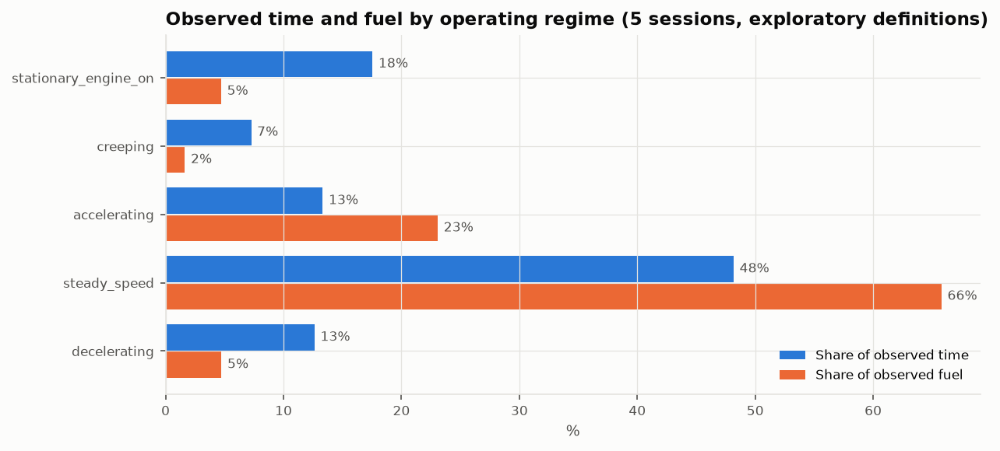
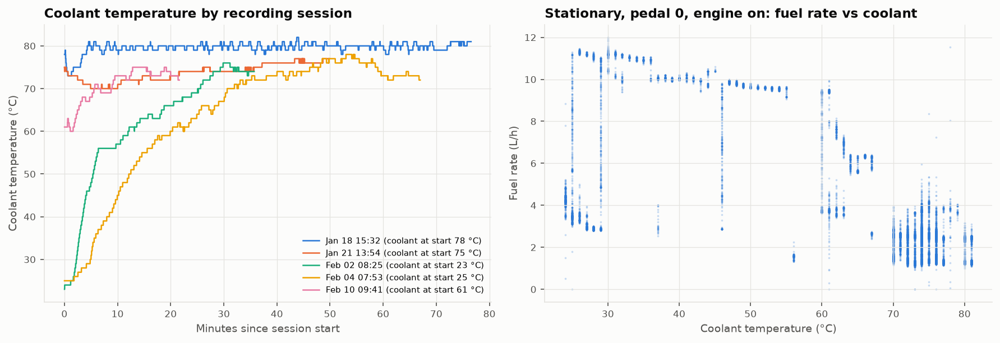
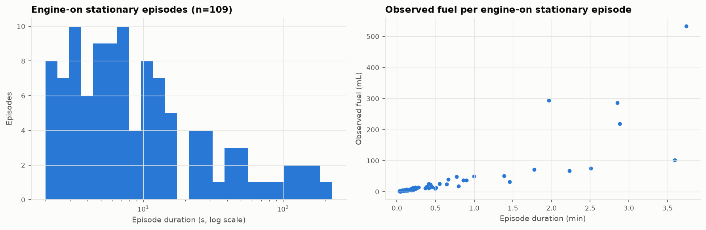

# FleetPulse Business Discovery v1

This is exploratory analysis of real telemetry from **one vehicle** (the Turku Renault T520, part_3). Its purpose is to find which operational problems the data can actually evidence, before choosing FleetPulse Solution #1.

Scope boundaries: no Gold, no dashboard, no ML, no LLM, no savings claims. All fuel figures are **observed fuel consumption**; none is labelled "waste".

**Reproduce:**
- `python -m fleetpulse.discovery.screen_archive`: light per-file screen of all 2,800 files.
- `bronze_ingest` + `silver_build` on `config/discovery_v1.txt`: the validated pipeline, unchanged.
- `python -m fleetpulse.discovery.explore`: the analysis.

Outputs: `data/discovery/analysis/` (`findings.json`, `episodes/*.csv`, `archive_engine_on_stationary.json`) and `reports/discovery_v1/figures/`.

## 1. How the driving windows were selected

**Step 1: screen the whole archive.** A light, single-core pass over the archive decoded only EEC1, CCVS and LFE per file, using the **validated reference decoder**. Across the whole archive it found:

| Measure | Value |
|---|---|
| Engine-on time | 22.0 h |
| Moving time | 13.6 h |
| Distance | 604 km |
| Fuel | 196 L |

The distance is concentrated on four days: Feb 4 (249 km), Jan 18 (181 km), Jan 19 (88 km) and Feb 2 (28 km). The 23.4-hour "continuous" recording of Feb 10–11 turned out to be **almost entirely engine-off**: the bus stays awake, but EEC1 shows no engine running.

**Step 2: choose recording sessions for variety of operation.** Sessions come from the 1 s gap audit and were chosen for variety, not to support any hypothesis. The previously analysed, mostly stationary Jan 19 09:24 window was excluded.

| Tag | Session start | Duration | Distance | Why selected | Files |
|---|---|---|---|---|---|
| A | 2021-01-18 15:32 | 76.6 min | 83.5 km | sustained driving up to 88 km/h | 78 |
| B | 2021-02-02 08:25 | 35.7 min | 28.0 km | cold start (coolant 23 °C) after a 168 h recording silence, then driving | 37 |
| C | 2021-02-04 07:53 | 67.0 min | 63.1 km | cold start (coolant 25 °C) after a 25.4 h silence, driving up to 90 km/h | 68 |
| D | 2021-02-10 09:41 | 21.6 min | 16.1 km | short mixed driving | 23 |
| E | 2021-01-21 13:54 | 49.9 min | 1.8 km | low-speed operation (≤ 15 km/h), a different regime | 52 |

The exact members are listed in `config/discovery_v1.txt`: 258 consecutive files per window, from `part_3/20210118151622791338.csv` onward.

**Bias warning.** The windows were chosen *for* driving, so they under-represent stationary operation. Section 6 therefore also reports archive-wide figures from the screen.

## 2. Dataset coverage

The data went through the validated Bronze → Silver pipeline (Parquet, `local[2]`, low priority) with no semantic changes.

| Measure | Value |
|---|---|
| Raw CAN frames | **12,900,258** (0 quarantined) |
| Decoded signal events | **2,196,397** |
| Telemetry rows (100 ms grid) | **152,532** in total; 150,462 in the 5 target sessions |
| Recording sessions | 17: the 5 target sessions + 12 edge fragments (3.4 min in total, mostly 9.8 s bus-wake bursts with the engine off), which are excluded from behaviour statistics |
| Observed duration | 4.18 h (4.14 h engine on) |
| Distance | **192.5 km** (integrated wheel speed; odometer counter agrees within 0.01 km per road session) |
| Fuel | **54.7 L** observed (integrated fuel rate; fuel counter agrees within 0.1 % per session) |
| Freshness | ≥ 99.9 % `fresh` for every message |

Two verified signals have limited use here:
- **Clutch switch:** not available throughout. This is the documented behaviour for this automated gearbox.
- **Cruise control:** active only 12.5 min, all in one session.

## 3. Descriptive characterisation (5 sessions, exploratory bands)

All bands are **dataset-specific exploratory definitions**, listed in `explore.py` and `findings.json`.

| Dimension | Time share | Fuel share |
|---|---|---|
| Speed: stationary (< 0.5 km/h) | 18.5 % | 4.7 % |
| creeping (0.5–5) | 7.4 % | 1.7 % |
| low (5–30) | 13.8 % | 6.8 % |
| medium (30–60) | 12.4 % | 11.9 % |
| higher (≥ 60) | 47.8 % | 75.0 % |
| RPM: idle band (300–700) | 24.5 % | 4.5 % |
| 700–1000 | 17.8 % | 9.4 % |
| 1000–1300 | 53.4 % | 81.5 % |
| 1300–1600 | 3.2 % | 4.4 % |
| Load: 0 | 9.9 % | 0.1 % |
| 11–25 % | 38.2 % | 25.1 % |
| 26–50 % | 28.0 % | 50.9 % |
| 51–75 % | 4.4 % | 13.9 % |
| 76–125 % | 1.3 % | 6.0 % |
| Pedal: 0 | 36.3 % | 12.1 % |
| > 50 % | 12.1 % | 34.5 % |
| Fuel rate: 10–30 L/h | 38.1 % | 55.1 % |
| > 30 L/h | 10.5 % | 32.3 % |
| Coolant: < 40 °C | 4.8 % | 2.1 % |
| 40–60 °C | 8.5 % | 10.0 % |

The engine runs almost entirely at 1,000–1,300 rpm when working; ≥ 1,600 rpm is 0.1 % of time. Operating regimes, built from the validated `label_states` definitions, where `steady_speed` means steady wheel speed, not cruise control:

| Regime | Time | Observed fuel |
|---|---|---|
| steady_speed | 48.2 % | 65.8 % |
| stationary_engine_on | 17.6 % | 4.7 % |
| accelerating | 13.3 % | 23.1 % |
| decelerating | 12.6 % | 4.7 % |
| creeping | 7.3 % | 1.6 % |



## 4. Candidate operating events (5 sessions)

Events are contiguous runs of at least 2 s within one recording session. Fuel is observed fuel from the integrated fuel rate.

| Event (exploratory definition) | Count | Sessions | Total | Median | Fuel | Distance | Evidence |
|---|---|---|---|---|---|---|---|
| A. Engine-on stationary (rpm ≥ 300, speed < 0.5) | 109 | 5/5 | 43.2 min | 7.2 s | 2.54 L | – | strong |
| B. Long engine-on stationary (≥ 5 min) | 0 in these windows | – | – | – | – | – | window bias; see §6 |
| C. Creeping (0.5–5 km/h) | 133 | 5/5 (105 in session E) | 16.7 min | 5.1 s | 0.80 L | 0.61 km | strong, concentrated in one session |
| D. High engine load (≥ 75 %) | 24 | 2/5 | 2.7 min | 4.3 s | 2.91 L | 3.4 km | weak (few, short) |
| E. High fuel rate (≥ 30 L/h) | 205 | 4/5 | 24.1 min | 4.4 s | 16.4 L (30 %) | 30.8 km | strong; median entry/exit speed about 80 km/h, pedal about 57 %, load about 49 % |
| F. Acceleration (≥ 0.5 m/s², 2 s smoothed) | 55 | 5/5 | 2.9 min | 2.8 s | 1.72 L | 1.7 km | moderate |
| G. Coasting, engine above idle (pedal 0, brake off, speed falling) | 164 | 5/5 | 13.6 min | – | 1.58 L | 15.6 km | strong; 60 % of samples at zero fuel rate |
| G. Coasting, engine at idle rpm | 47 | 4/5 | 4.1 min | – | 0.11 L | 4.5 km | strong pattern; driveline state unverifiable |
| H. Brake applications (SPN 597) | 186 | 5/5 | 21.9 min | 4.1 s | – | – | strong; 84 slowing, 42 to standstill, 60 while stationary |
| I. Cruise control active (SPN 595) | 2 | 1/5 | 12.5 min | 376 s | 3.71 L | 17.1 km | weak (one session) |
| J. Warm-up idle (stationary, coolant < 70 °C) | 8 | 3/5 | 12.6 min | 79 s | 1.39 L | – | moderate |

**J/K. Cold start and temperature.**
- **Time to reach 70 °C coolant:** 25.1 min (B, from 23 °C) and 30.6 min (C, from 25 °C).
- **Raised warm-up idle, seen in both cold starts:** stationary with pedal 0 and coolant 24–55 °C, the engine runs at about **900 rpm and 10–11 L/h** (B: 4.2 min, 0.71 L; C: 0.5 min). Warm idle is **600 rpm and 1.4–3.5 L/h**.
- **Ambient temperature (AMB SPN 171) is not trustworthy as outside air temperature.** It reads +19.9 °C in a −17 °C morning (session C), consistent with sensor heat soak. It is used only as context.



## 5. Signal relationships

These are correlations and regimes, not causation. Spearman correlations are computed with the engine on.

**Fuel rate** correlates with:

| Engine load | Accelerator pedal | RPM | Vehicle speed |
|---|---|---|---|
| **0.94** | 0.83 | 0.67 | 0.57 |

**Other pairs, while moving:**
- engine load vs pedal: 0.82;
- engine load vs speed: 0.39 (load is not explained by speed alone).

**Regimes.**
- **Fuel per unit load rises with engine speed.** Median L/h per load-% is 0.20 in the idle band, 0.44 at 700–1000 rpm, 0.71 at 1000–1300 rpm and 0.79 at 1300–1600 rpm. The same load % costs about 3.5× more fuel at cruising rpm than at idle rpm. This is consistent with FMS defining load relative to maximum torque *at the current rpm* (figure 05).
- **Discrete gear-ratio bands.** Engine speed against vehicle speed forms distinct rays, one per gear ratio (figure 08), as seen in earlier stages.
- **Coolant vs idle fuel.** Idle fuel rate is 4.2 L/h below 40 °C, 9.6 L/h at 40–60 °C (the raised-idle phase), 2.5 L/h at 60–75 °C and 1.4 L/h at ≥ 75 °C. Only two cold starts contribute.
- **Cruise control (single session, observational).** At ≥ 60 km/h, 21.6 L/100 km with cruise on vs 26.3 L/100 km with it off; speed standard deviation 0.5 vs 5.9 km/h. Grade, traffic, load and speed differ, so **no efficiency claim is possible**.

## 6. Fuel and operating efficiency

**In the 5 driving sessions** (observed fuel 54.7 L):
- stationary engine-on: 2.54 L (4.7 %);
- creeping: 0.80 L;
- accelerating: 23.1 %;
- steady speed: 65.8 %.

**Across the whole archive** (screen of all 17 engine-running sessions, the same validated decoder, 300 ms as-of matching of fuel rate to speed):

| Measure | Value |
|---|---|
| Engine-on stationary | **8.3 h = 37.8 % of engine-on time** |
| Fuel while engine-on stationary | **19.6 L = 10.0 % of 196 L observed** |
| Mean stationary fuel rate | 2.36 L/h |
| Sessions with > 15 min of it | **11 of 17** (8 with > 30 min) |

Two operating profiles appear:
- **Road sessions** (e.g. Feb 4, Jan 18): 5–29 % of engine time stationary, 1–5 % of fuel.
- **Low-mobility sessions** (Jan 19, Jan 21, Feb 10 10:10): **49–77 % of engine time stationary, 36–64 % of their fuel**, with under 7 km driven per session.

## 7. Repeated patterns

- **Engine-on stationary time.** 109 episodes in 5/5 driving sessions, and more than 15 min in 11/17 engine sessions archive-wide. **8.3 h and 19.6 L observed across the archive.**
- **Low-mobility, engine-on sessions.** 8 sessions across 3 days: 0.5–1.9 h engine on, ≤ 6.5 km driven, and 49–77 % of the engine time stationary.
- **Short high-fuel-rate bursts at road speed.** 205 bursts of ≥ 30 L/h (median 4.4 s) in 4/5 sessions, totalling 24 min: 10.5 % of time but **30 % of observed fuel**.
- **Coasting with the engine above idle and fuel cut to zero.** 164 episodes in 5/5 sessions (60 % of samples at 0 L/h).
- **Coasting with the engine at idle rpm.** 47 episodes in 4/5 sessions, at about 1.4 L/h. The Stage 3 analysis found the same pattern in other windows.
- **Cold-start warm-up.** 25–31 min to reach 70 °C, with a raised ~900 rpm idle at ~10 L/h while stationary. It occurs in 2/2 observed cold starts. The earlier-analysed Jan 19 09:24 start began partly warm (59 °C) and then idled 19.5 min.
- **Brake use.** 186 applications in 5/5 sessions, 60 of them while already stationary (brake held at stops).



## 8. Candidate business problems (not a product decision)

**Candidate 1: Engine-on stationary time (idling)**
- **Observed:** 8.3 h (37.8 %) of engine-on time and 19.6 L (10 %) of observed fuel archive-wide. Recurs in 11/17 sessions, and is dominant in low-mobility sessions.
- **Potential consequence (inferred):** fuel consumption and engine hours with no distance produced; possibly maintenance exposure through engine hours.
- **Signals:** EEC1 SPN 190, CCVS SPN 84, LFE SPN 183, HRLFC SPN 5054 (reconciliation), ET1 SPN 110.
- **KPI:** engine-on stationary hours and litres per session/day; share of engine hours; distribution of episode durations.
- **Actionability:** investigate long or frequent stationary engine-on periods by location and time.
- **Limitations:**
  - no GPS, location or job context;
  - PTO use is unknown here (CCVS SPN 976 was only checked in the 15-min Stage 2 window, where it was constant "off");
  - cab heating, loading, queuing and cold-weather operation cannot be distinguished;
  - one vehicle.

**Candidate 2: Low-mobility engine-on sessions**
- **Observed:** 8 sessions with 0.5–1.9 h engine on and ≤ 6.5 km, 49–77 % of engine time stationary, and repeated creeping (session E: 105 creeping episodes).
- **Consequence (inferred):** utilisation and time consumed without road distance.
- **KPI:** km per engine-hour per session; share of creeping and stationary time.
- **Limitations:** this may be legitimate yard or terminal work, and job context is unknown.

**Candidate 3: High-fuel-rate bursts at road speed**
- **Observed:** 205 episodes of ≥ 30 L/h in 4/5 sessions, 30 % of observed fuel in 10.5 % of time. Median pedal about 57 %, speed about 80 km/h.
- **Consequence (inferred):** these bursts dominate fuel use, and could reflect driving style (pedal use) or road grade.
- **KPI:** share of fuel above X L/h, pedal-demand distribution, events per 100 km.
- **Limitations:**
  - no grade or altitude, no vehicle mass (VW PGN absent), no route data;
  - cannot separate driver choice from road and load demand.

**Candidate 4: Cold-start warm-up**
- **Observed:** 25–31 min to reach 70 °C; raised ~900 rpm idle at ~10 L/h while stationary cold, versus ~2 L/h warm idle.
- **Consequence (inferred):** fuel and engine wear during cold operation in winter.
- **KPI:** minutes from start to 70 °C coolant, stationary warm-up minutes and litres per cold start.
- **Limitations:**
  - only 2–3 cold starts;
  - whether the raised idle is engine-controlled or driver-selected is unknown (SPN 968 not decoded);
  - ambient temperature is unreliable.

**Candidate 5: Coasting behaviour**
- **Observed:** coasting with fuel cut (engine above idle) is common. Coasting at idle rpm (47 episodes) burns about 1.4 L/h.
- **Consequence:** unclear. Idle-rpm coasting may be an intended eco-roll/freewheel feature.
- **Limitations:** driveline engagement (ETC1 SPN 560) is not verified. **Weak business framing.**

**Candidate 6: Cruise-control use**
- **Observed:** used in 1 of 5 sessions.
- **Limitations:** too little data (2 episodes) for anything beyond "cruise use is measurable".

## 9. Evidence matrix

| Candidate | Observations | Repeatability | Measurable duration | Measurable fuel/distance | Signals | Detection confidence | Missing context |
|---|---|---|---|---|---|---|---|
| 1 Engine-on stationary | 109 episodes (5 sessions); 8.3 h archive | 11/17 sessions > 15 min | yes (100 ms) | yes: 19.6 L archive; counter-reconciled per session | EEC1, CCVS, LFE, HRLFC, ET1 | **high** | location, job, heater/PTO use, driver |
| 2 Low-mobility sessions | 8 sessions | 3 days | yes | yes (fuel, km per engine-hour) | + VDHR | high (detection) / low (interpretation) | job/yard context |
| 3 High-fuel-rate bursts | 205 episodes | 4/5 sessions | yes (24 min) | yes: 16.4 L, 30.8 km | LFE, EEC2, CCVS, EEC1 | high (detection) / low (attribution) | grade, mass, route |
| 4 Cold-start warm-up | 2–3 starts | 2/2 cold starts | yes (25–31 min) | yes (0.7 L stationary warm-up in B) | ET1, EEC1, LFE, CCVS | medium | ambient (unreliable), cause of raised idle, more starts |
| 5 Coasting | 211 episodes | 5/5 | yes | small (1.7 L) | EEC2, CCVS, EEC1, LFE | medium | driveline state (ETC1) |
| 6 Cruise control | 2 episodes | 1/5 | yes | observational only | CCVS SPN 595 | low | more sessions, route |

## 10. Figures (`reports/discovery_v1/figures/`)

1. `01_session_sustained_driving.png`: speed, RPM, fuel rate and coolant for session A.
2. `02_session_cold_start.png`: the same for session B.
3. `03_operating_distributions.png`
4. `04_fuel_by_regime.png`
5. `05_fuel_vs_load_by_rpm.png`
6. `06_engine_on_stationary_episodes.png`
7. `07_warm_up.png`
8. `08_rpm_vs_speed.png`

## 11. Limitations

- **One vehicle, about 3 weeks.** Nothing generalises to a fleet.
- **No context:** no GPS, route, grade, payload (VW PGN absent), driver ID (DI absent) or job/task data.
- **Unknown timezone.** Timestamps are logger-local, so time-of-day patterns are uncertain.
- **Selection bias.** The windows were selected for driving; archive-wide idle figures come from a lighter screen that uses the same decoder but a simpler time alignment (300 ms as-of matching per file).
- **Ambient temperature** is unreliable when stationary.
- **Clutch switch** is not available; ETC1/EBC1 (driveline, brake pedal position, ABS) are not verified, so they are not decoded.
- **"Observed fuel"** is FMS fuel rate integrated over time. It reconciles with the high-resolution fuel counter within 0.1 %, but FMS itself describes these values as indications, not contractual.
- **No event** here can be called avoidable or wasteful without operational context.

## 12. Questions for the next investigation

1. Does engine-on stationary time cluster by time of day or by recording day? (Only valid if the timezone can be established.)
2. In low-mobility sessions, is the engine-on stationary time one long idle or many short stops? Is it associated with warm-up (coolant) or with sustained operation?
3. Do high-fuel-rate bursts coincide with acceleration from low speed, or with sustained climbs at constant speed? This could be checked with speed trend vs fuel rate, and without grade data.
4. Is the ~900 rpm warm-up idle present in *every* cold start? Every cold start in the archive can be found from ET1 at session start.
5. Is VI (VIN via BAM) decodable, so that the dataset vehicle identity could be confirmed?
6. Would ETC1 (driveline engaged) be verifiable from an authoritative source, to settle whether idle-rpm coasting is eco-roll?

## 13. AI Fleet Analyst: evidence object proposal (no LLM integrated)

The analyst would only *explain* deterministic results. Every number comes from FleetPulse computations, with lineage.

```json
{
  "evidence_id": "evt-2021-02-02-warmup-001",
  "event_type": "engine_on_stationary",
  "definition": {"name": "engine_on_stationary", "version": "discovery-v1",
                 "rule": "engine_speed_rpm >= 300 AND wheel_speed_kph < 0.5 for >= 2 s",
                 "thresholds_are_dataset_specific": true},
  "vehicle_id": "turku-renault-t520-6x2",
  "recording_session_id": "turku-renault-t520-6x2-20210202T082528742234",
  "start": "2021-02-02T08:25:31.100", "end": "2021-02-02T08:29:15.500",
  "timestamp_timezone": "unknown (logger local)",
  "duration_min": 3.74,
  "metrics": {"fuel_consumed_l": 0.61, "fuel_method": "LFE SPN 183 integrated, 100 ms grid",
              "distance_km": 0.0, "mean_engine_speed_rpm": 900.0, "mean_engine_load_pct": 22.0,
              "mean_fuel_rate_lph": 9.9, "coolant_start_c": 24.0, "coolant_end_c": 52.0},
  "context_metrics": {"session_engine_on_min": 35.7, "session_share_of_fuel_pct": 8.2},
  "supporting_evidence": [
    {"signal": "engine_speed_rpm", "spn": 190, "pgn": 61444, "freshness": "fresh 100%"},
    {"signal": "wheel_speed_kph", "spn": 84, "pgn": 65265, "freshness": "fresh 100%"},
    {"signal": "fuel_rate_lph", "spn": 183, "pgn": 65266, "reconciled_with": "HRLFC SPN 5054 within 0.1% per session"}
  ],
  "confidence": {"detection": "high", "interpretation": "low",
                 "reasons": ["verified FMS signals", "counter reconciliation passed"]},
  "limitations": ["no location or job context", "cause of raised idle not verifiable (SPN 968 not decoded)",
                  "ambient temperature unreliable when stationary", "single vehicle"],
  "lineage": {"silver_build_id": "…", "bronze_commit_ids": ["…"], "source_files": ["part_3/…csv"]},
  "prohibited_claims": ["fuel_waste", "cost_savings", "driver_fault"]
}
```

**Rules for the future LLM layer:**
- It may paraphrase `metrics`, `confidence` and `limitations`.
- It may not compute new vehicle metrics or assert anything listed in `prohibited_claims`.
- It must cite `evidence_id`.

*(The numbers in this example are illustrative of the format; the real objects would be generated from `episodes/*.csv`.)*
